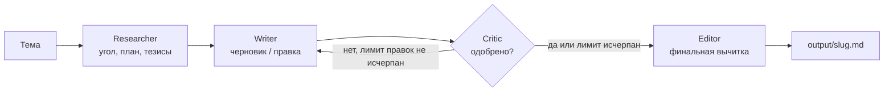

# multi-agent-writer

Мультиагентный конвейер, в котором четыре LLM-агента вместе пишут статью: исследователь, автор, критик и редактор. Это наглядный пример оркестрации агентов на чистом OpenAI SDK для тех, кто хочет понять, как такие системы устроены изнутри.


## Зачем

Один запрос к LLM вида «напиши статью» обычно даёт ровный, но поверхностный текст. Здесь работа разбита на роли, как в редакции. Исследователь продумывает угол и план, автор пишет черновик, критик находит слабые места и возвращает текст на доработку, редактор вычитывает финал. Агентных фреймворков нет: вся оркестрация лежит в одном файле [pipeline.py](multi_agent_writer/pipeline.py) примерно на 60 строк, и её легко прочитать целиком.

## Что умеет

- 🧭 **Researcher** превращает тему в угол подачи, план из 4–6 разделов и ключевые тезисы.
- ✍️ **Writer** пишет черновик в Markdown на 600–900 слов и переписывает его по замечаниям.
- 🧐 **Critic** оценивает структуру, ясность, полноту и правдоподобие и возвращает JSON-вердикт `{approved, feedback}`.
- 🪄 **Editor** делает финальную вычитку грамматики и ритма и следит, чтобы статья начиналась с заголовка `# Title`.
- 🔁 Цикл Writer ↔ Critic ограничен `MAX_REVISIONS` (по умолчанию 2). Если критик так и не одобрил текст, редактор всё равно отрабатывает: лучше статья с оговорками, чем никакой.
- 🛟 Если критик вернул невалидный JSON, ответ считается одобрением. Это защищает от бесконечного цикла.
- 🌐 Тема может быть на любом языке, и агенты пишут на языке темы.
- Результат сохраняется в `output/<slug-темы>.md`.

## Схема



## Стек

- Python 3.10+
- OpenAI SDK (Chat Completions), модель по умолчанию `gpt-4o-mini`
- python-dotenv: настройки из `.env`
- pytest: тесты на «заскриптованной» фейковой LLM

## Быстрый старт

```bash
git clone https://github.com/StepanCEO/multi-agent-writer
cd multi-agent-writer
pip install -r requirements.txt
cp .env.example .env          # впишите OPENAI_API_KEY
python -m multi_agent_writer "Почему RAG лучше дообучения для FAQ-ботов"
```

Пример лога (сколько будет правок, зависит от ответов модели):

```
$ python -m multi_agent_writer "Why RAG beats fine-tuning for FAQ bots"
Researcher: gathering key points for 'Why RAG beats fine-tuning for FAQ bots'
Writer: drafting
Critic: reviewing draft (attempt 1)
Writer: revising (revision 1 of 2)
Critic: reviewing draft (attempt 2)
Critic: approved
Editor: final polish

Done: output/why-rag-beats-fine-tuning-for-faq-bots.md (revisions: 1)
```

Параметры командной строки:

| Флаг | Что делает |
|------|------------|
| `-o`, `--output` | путь к итоговому `.md` (по умолчанию `output/<slug-темы>.md`) |
| `-q`, `--quiet` | не выводить лог прогресса |

## Роли агентов

| Агент | Роль | Что возвращает |
|-------|------|----------------|
| Researcher | Превращает тему в угол подачи, план и ключевые тезисы | заметки для автора |
| Writer | Пишет черновик в Markdown на 600–900 слов, правит по замечаниям | черновик |
| Critic | Оценивает структуру, ясность, полноту и правдоподобие | `{approved, feedback}` |
| Editor | Финальная вычитка, заголовок `# Title` | готовая статья |

Каждый агент получает не клиент OpenAI, а функцию `complete(system, user) -> str`. Благодаря этому весь конвейер тестируется с фейковой LLM, без сети и API-ключа.

## Настройки (`.env`)

| Переменная | По умолчанию | Описание |
|------------|--------------|----------|
| `OPENAI_API_KEY` | — | обязательно |
| `MODEL` | `gpt-4o-mini` | любая модель Chat Completions |
| `MAX_REVISIONS` | `2` | максимум циклов Writer ↔ Critic |
| `TEMPERATURE` | `0.7` | температура генерации |

## Как устроено

```
multi_agent_writer/
├── __main__.py        # CLI: тема → статья в output/
├── config.py          # настройки из .env
├── llm.py             # тонкая обёртка над OpenAI SDK
├── pipeline.py        # оркестрация и цикл правок
└── agents/
    ├── base.py        # тип CompleteFn
    ├── researcher.py
    ├── writer.py
    ├── critic.py      # разбор JSON-вердикта (в том числе обёрнутого в ```)
    └── editor.py
tests/
└── test_pipeline.py   # тесты оркестрации на фейковой LLM
```

## Тесты

```bash
pip install pytest
python -m pytest
```

Тесты проверяют, что при одобрении с первого раза каждый агент вызывается ровно один раз, что после отказа критика запускается правка, что лимит правок соблюдается, а также разбор JSON в ```-блоке и реакцию на «мусорный» ответ критика.

## Лицензия

[MIT](LICENSE)

## Автор

**Степан** — fullstack и AI-разработчик
Портфолио: [stepanceo.github.io/Portfolio](https://stepanceo.github.io/Portfolio/) · Telegram: [@SStepCEO](https://t.me/SStepCEO)
